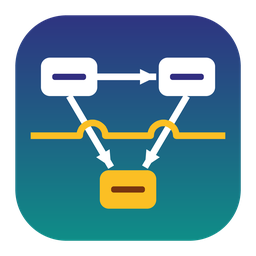

# FrameMap Studio

A desktop app, written in Rust, for drawing **conceptual frameworks**, **systems maps / causal loop diagrams**, logic models and flowcharts, then exporting them straight into **Microsoft Word**. It runs on **Windows and macOS** (and Linux) as a single small program with no internet connection needed.



## What it does

| Need | How FrameMap Studio handles it |
|---|---|
| Shapes | 14 shapes: rectangle, rounded rectangle, ellipse, circle, diamond, triangle, parallelogram, hexagon, octagon, cylinder, document, cloud, sticky note, free text |
| Styling | Fill, border colour, border width, solid/dashed/dotted borders, text colour, font size, bold, shadow |
| Drag and connect | Hover a shape, drag from a blue dot to another shape. Drop on empty canvas to create **and** connect a new shape in one move |
| Arrows | Single-sided, reverse, **double-sided** or plain lines. Heads: filled arrow, open arrow, hollow triangle, diamond, circle, bar. Adjustable arrow size, line width, colour, dash style, and labels (e.g. `+` / `−` for causal loops) |
| Straight and flexible lines | Straight, **curved** (smooth, bendable) or **elbow** (right-angled). Drag the hollow dots to add bends, drag solid dots to move them, double-click a bend to remove it |
| Lines must not cross | Connectors may meet at a shape but should not cross. **Minimise crossings** automatically re-routes lines to avoid crossings without passing through shapes or hiding other lines. Any crossing that truly can't be avoided is drawn with a **hop (bridge)** so readers can see the lines are not joined. A gap style is also available. The status bar always shows the crossing count |
| Join objects as one | Select shapes and press **Ctrl+G** (Group). Clicking any member selects the whole group so it moves together; connectors between them come along. **Ctrl+Shift+G** ungroups |
| Everything reversible | Unlimited-style undo/redo (300 steps), plus **Edit ▸ History** to jump back or forward to any step. Unsaved-changes prompts on close/open/new |
| Export to Word | **File ▸ Export to Word** makes a `.docx` (A4 portrait or landscape) with a title, the figure as a **sharp vector image** (high-resolution fallback for older Word versions) and a caption such as *Figure 1: …*. PNG and SVG export too |
| Templates | Conceptual framework (independent → dependent with intervening variables), systems map (causal loops), logic model / theory of change |
| Editing comforts | Copy/paste/duplicate, align and distribute, bring to front/back, snap to grid, zoom and pan, keyboard nudging |

Diagrams save as `.fmap` files (readable JSON). On Windows, double-clicking a `.fmap` file opens it in the app.

## Getting the installers

Rust apps must be compiled on (or for) each operating system. There are two ways:

### Option A — automatic (recommended): GitHub Actions
1. Create a repository on GitHub and upload this folder.
2. Open the **Actions** tab → **Build installers** → **Run workflow**.
3. After about 10 minutes, download the artifacts:
   - `FrameMap-Studio-Setup-1.0.0.exe` — Windows installer (Start-menu + desktop shortcut, `.fmap` file association, uninstaller)
   - `FrameMap-Studio-1.0.0-windows-portable.zip` — runs without installing
   - `FrameMap-Studio-1.0.0.dmg` — macOS (Intel and Apple Silicon)

Pushing a tag such as `v1.0.0` also publishes these as a GitHub Release.

### Option B — build on your own computer
**Windows**
1. Install Rust from <https://rustup.rs> (accept the Visual Studio C++ Build Tools prompt).
2. Optional, for the installer: install NSIS from <https://nsis.sourceforge.io>.
3. Double-click `build-windows.bat` (or run it in a terminal). Output goes to `dist\`.

**macOS**
1. Install Xcode command-line tools (`xcode-select --install`) and Rust from <https://rustup.rs>.
2. Run `bash packaging/macos/bundle.sh`. Output: `dist/FrameMap-Studio-1.0.0.dmg`.

### First launch notes
- **Windows**: the installer isn't code-signed, so SmartScreen may say "Windows protected your PC". Click **More info → Run anyway**.
- **macOS**: the app is ad-hoc signed but not notarised. The first time, right-click the app → **Open** → **Open**. On macOS, open `.fmap` files with **File ▸ Open** (double-clicking a file in Finder doesn't pass it to the app yet).

## Quick guide
1. **File ▸ New from template** to start from a framework, or pick a shape on the left and click the canvas.
2. Type the label straight away; press **Esc** or click outside when done. Double-click any shape or connector later to edit its text.
3. Hover a shape and drag from a **blue dot** to another shape to connect them.
4. Click a connector to change its path (straight / curved / elbow), direction (→ ← ↔ —), arrow heads, width, colour and label.
5. Press **Minimise crossings** in the toolbar. Remaining crossings are shown with hops.
6. **File ▸ Export to Word** (Ctrl+E) and choose portrait or landscape.

| Shortcut (Cmd on Mac) | Action |
|---|---|
| Ctrl+Z / Ctrl+Y (or Ctrl+Shift+Z) | Undo / redo |
| Ctrl+C / Ctrl+V / Ctrl+X / Ctrl+D | Copy / paste / cut / duplicate |
| Ctrl+G / Ctrl+Shift+G | Group / ungroup |
| Delete or Backspace | Delete selection |
| Arrow keys (Shift = 10 px) | Nudge |
| V / C | Select tool / connect tool |
| F2 | Edit text of selected shape |
| Ctrl+scroll, Ctrl+0 | Zoom, fit to window |
| Scroll, middle-drag, Space+drag | Pan |
| Alt+click | Select one shape inside a group |
| Ctrl+S / Ctrl+Shift+S / Ctrl+O / Ctrl+N | Save / save as / open / new |
| Ctrl+E | Export to Word |

## Command-line export (batch use)
```
framemap --export diagram.fmap figure.docx [--landscape] [--minimize]
framemap --export diagram.fmap figure.png
framemap --export template:conceptual starter.fmap
```

## Project layout
```
src/model.rs      document model (shapes, connectors, groups) — saved as .fmap JSON
src/geom.rs       shape outlines, routing, crossing detection, hops, crossing minimiser
src/scene.rs      turns a diagram into drawing primitives (shared by screen and exports)
src/export.rs     PNG (tiny-skia), SVG and Word .docx writers
src/app.rs        the editor UI (egui): canvas, panels, menus, undo/redo history
src/templates.rs  starter templates
packaging/        Windows NSIS installer, macOS app bundle + dmg script
.github/workflows GitHub Actions that build the installers
```

Author: Muruhukye Jacob · MIT License
